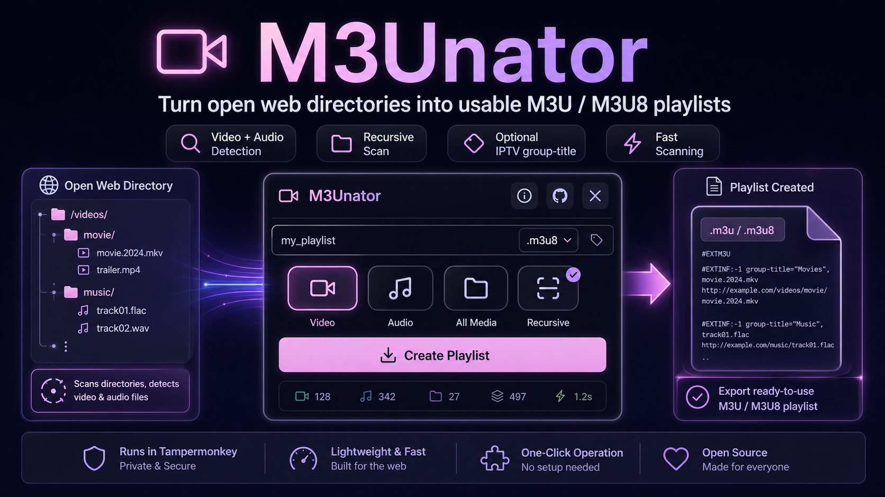

# M3Unator - Web Directory Playlist Creator

  
  
  
  

<h3 align="center">Create M3U and M3U8 playlists directly from web directory listings.</h3>

  M3Unator is a userscript for turning public web server indexes into playable media playlists. It detects supported directory listing pages, scans video and audio files, follows subdirectories when requested, and exports clean playlist files that work with common media players and IPTV tools.

  
  
  
  

## What M3Unator Does

M3Unator runs in your browser on supported directory listing pages. When a page exposes files through a classic web server index, M3Unator adds a compact launcher button. From there, you can choose what to scan, generate a playlist, monitor progress, and download the result without uploading anything to another service.

It is designed for open directory pages generated by servers such as Apache, Nginx, LiteSpeed, Lighttpd, IIS, and Caddy. It can also handle similar listing layouts when the page structure provides enough directory and file signals.

## What's New in v1.1.0

- Optional IPTV `group-title` metadata with manual text or first-folder grouping.
- `.m3u8` export path with UTF-8 BOM and an HLS-friendly MIME type.
- Adaptive parallel scanning in normal and aggressive modes.
- Duplicate playlist entry prevention across large file batches.
- Broader directory listing detection for Apache, Nginx, LiteSpeed, Lighttpd, IIS, and Caddy style pages.
- Improved startup detection that avoids mounting on ordinary non-listing pages.
- Better large-directory responsiveness through batched file processing.
- Updated local logic tests, browser smoke tests, and release QA guidance.

## Features

### Playlist Generation

- Exports Extended M3U playlists as `.m3u`.
- Exports UTF-8 `.m3u8` playlists for better compatibility with HLS/IPTV-oriented players.
- Adds optional `group-title="..."` metadata with manual text or automatic first-folder grouping.
- Keeps readable nested path labels in playlist titles, and preserves remaining paths when first-folder grouping is enabled.
- Sorts playlist entries by depth and natural title order.
- Prevents duplicate output entries when the same media URL is encountered more than once.

### Media Detection

- Detects common video and audio formats from directory links.
- Lets you include video, audio, or both.
- Supports international filenames through URL decoding and UTF-8 playlist output.
- Filters non-media files out of the generated playlist.

### Directory Scanning

- Scans the current directory or recursively scans subdirectories.
- Supports custom scan depth from 1 to 99 levels.
- Uses batched file processing for large directories.
- Tracks visited URLs to avoid repeated work.
- Skips recursive fetches when a linked HTML page is not a directory listing.

### Performance Controls

- Normal mode starts at 4 concurrent directory requests and adapts up to 12.
- Aggressive mode starts at 6 concurrent directory requests and adapts up to 20 for trusted fast servers.
- Adaptive throttling reacts to request failures, timeouts, rate limiting, and event-loop lag.
- Network requests use timeout and retry handling with exponential backoff.
- Permanent `401`, `403`, `404`, and `410` responses are not retried unnecessarily.

### User Interface

- Floating launcher that appears only on supported directory listing pages.
- Dark popup interface with playlist name, format selector, group-title control, media toggles, depth controls, and fast-scan switch.
- Pause, resume, and cancel controls while scanning.
- Live counters for total files, video files, audio files, folders, depth, and errors.
- Recent Activity panel with categorized log entries and status indicator.
- Toast notifications for important scan and export events.
- About dialog with the active userscript version.

### Privacy and Security

- Runs locally in your browser through a userscript manager.
- Does not upload scanned links or playlists to a remote service.
- Uses browser-side URL parsing and validation before scanning links.
- Escapes playlist metadata where needed for safer output.

## Installation

1. Install a userscript manager:
   - [Tampermonkey](https://www.tampermonkey.net/) is recommended.
   - [Violentmonkey](https://violentmonkey.github.io/) is also supported.
2. Install M3Unator:
   - [Install from Greasy Fork](https://greasyfork.org/en/scripts/521593-m3unator-web-directory-playlist-creator)
   - [Install from GitHub](https://raw.githubusercontent.com/hasanbeder/M3Unator/main/M3Unator.user.js)

For Tampermonkey v5.0 and newer, browser extension developer mode may need to be enabled before userscripts can run.

## Quick Start

1. Open a supported web directory listing.
2. Click the M3Unator launcher in the top-right corner.
3. Enter a playlist name.
4. Choose `.m3u` or `.m3u8`.
5. Select Video, Audio, or both.
6. Choose current-directory scanning or a recursive depth.
7. Click **Create Playlist**.
8. Download the generated playlist when the scan finishes.

## Usage

### Scan Scope

Use **Current directory** when you only want media files linked directly from the current page. Use **Custom depth** when you want M3Unator to follow subdirectories. A depth of `1` scans one level below the current page; higher values scan deeper trees.

### Media Type Selection

The Video and Audio toggles control what goes into the playlist. Turning off one media type prevents matching files from being added while the scan continues to process supported directories.

### Playlist Format

| Format | Best For | Behavior |
|--------|----------|----------|
| `.m3u` | General media players | Extended M3U text playlist |
| `.m3u8` | UTF-8, HLS, and IPTV workflows | UTF-8 playlist with BOM and HLS-friendly MIME handling |

### IPTV Group Title

Use the tag button beside the format selector to configure optional IPTV `group-title` metadata.

- Leave **Group Title** empty to keep the standard output: `#EXTINF:-1,Title`.
- Type a custom value to export every item with `group-title="Name"`.
- Click the folder button inside the **Group Title** field to use the first scanned subfolder as the category. The first folder is removed from the visible title so entries do not repeat the category.

In **First folder** mode, files in the scan root use the playlist name as their `group-title`; files inside subfolders use the first folder name. Deep paths after that first folder remain in the visible title.

### Fast Scan

The compact switch beside **Create Playlist** enables aggressive scanning. Use it for trusted, responsive servers where higher request concurrency is acceptable. Normal mode is the safer default for unknown or slower hosts.

## Supported Directory Listings

M3Unator is tested against these listing families:

- Apache `mod_autoindex`
- Nginx autoindex
- LiteSpeed and OpenLiteSpeed listings
- Lighttpd `mod_dirlisting`
- IIS directory browsing
- Caddy `file_server browse`

It also includes heuristics for similar index pages, but it intentionally avoids mounting on ordinary websites that only happen to contain many links.

## Supported Formats

### Video

`mp4` `mkv` `avi` `webm` `mov` `flv` `wmv` `m4v` `mpg` `mpeg` `3gp` `vob` `ts` `mts` `m2ts` `divx` `xvid` `asf` `ogv` `rm` `rmvb` `wtv` `qt` `hevc` `f4v` `swf` `vro` `ogx` `drc` `gifv` `mxf` `roq` `nsv`

### Audio

`mp3` `m4a` `wav` `flac` `aac` `ogg` `wma` `opus` `aiff` `ape` `mka` `ac3` `dts` `m4b` `m4p` `m4r` `mid` `midi` `mp2` `mpa` `mpc` `ra` `tta` `voc` `vox` `amr` `awb` `dsf` `dff` `alac` `wv` `oga` `sln` `aif` `pcm`

## Browser Compatibility

| Browser | Support | Notes |
|---------|---------|-------|
| Chrome | Supported | Recommended with Tampermonkey |
| Firefox | Supported | Works with Tampermonkey or Violentmonkey |
| Edge | Supported | Chromium-based Edge is supported |
| Opera | Supported | Chromium-based Opera is supported |
| Safari | Limited | Userscript manager support can vary |

## Project Documentation

- [Changelog](CHANGELOG.md)
- [Wiki](https://github.com/hasanbeder/M3Unator/wiki)

## FAQ

<strong>Why does the launcher not appear?</strong>

M3Unator only mounts on pages that look like supported directory listings. If the page is a normal website, a file browser rendered by JavaScript, or a blocked/private page, the launcher may not appear.

<strong>Why are some files skipped?</strong>

Files can be skipped when their extensions are unsupported, links are inaccessible, responses fail permanently, or the page is not recognized as a directory listing during recursive scanning.

<strong>Should I use normal or aggressive scanning?</strong>

Use normal mode for most hosts. Use aggressive mode only when you trust the server and want higher parallel request limits for faster recursive scans.

<strong>Does M3Unator download the media files?</strong>

No. It reads directory listing pages, collects media URLs, and writes those URLs into a playlist file. Your media player handles playback afterward.

## License

M3Unator is licensed under the GNU General Public License v3.0. See [LICENSE](LICENSE) for details.

## Support

- GitHub: [@hasanbeder](https://github.com/hasanbeder)
- X: [@hasanbeder](https://x.com/hasanbeder)
- Issues: [Bug Reports and Feature Requests](https://github.com/hasanbeder/M3Unator/issues)
- Discussions: [Community Forum](https://github.com/hasanbeder/M3Unator/discussions)
